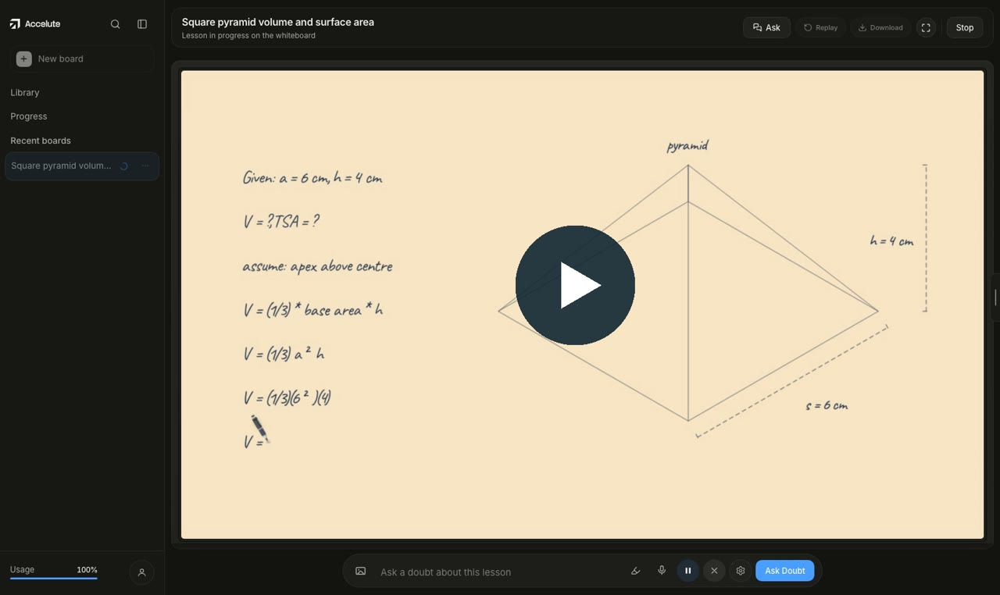
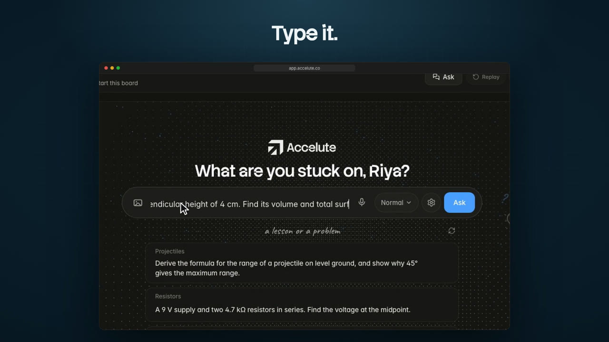
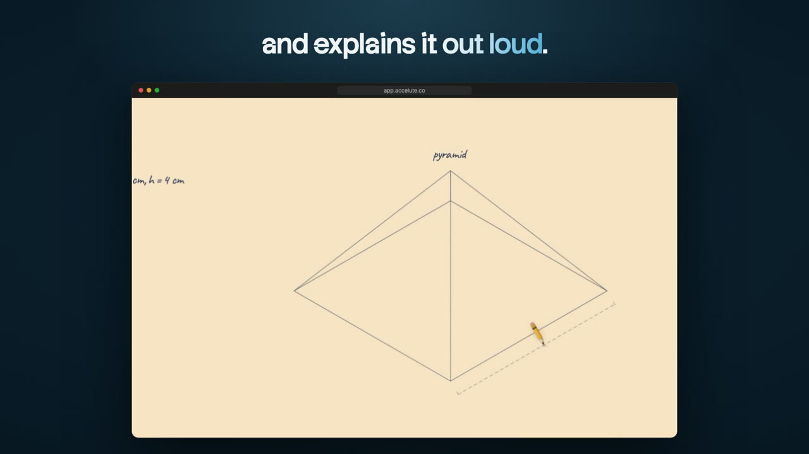
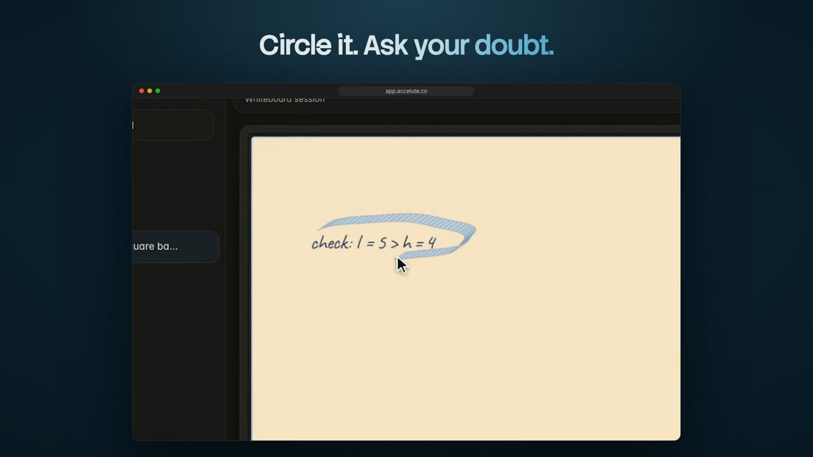
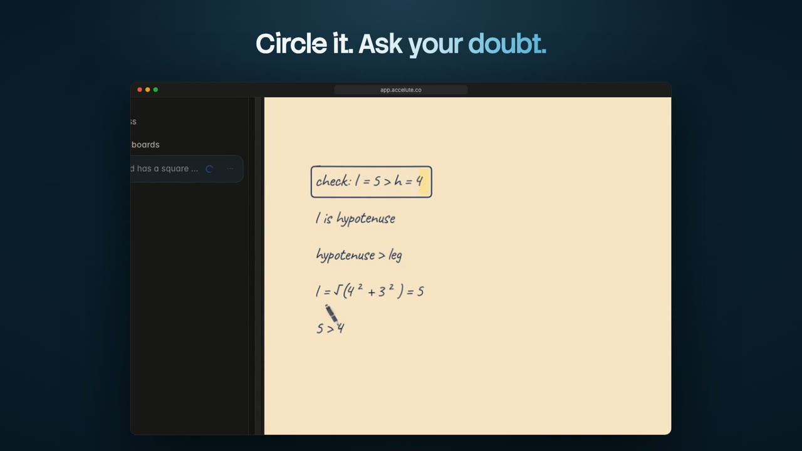
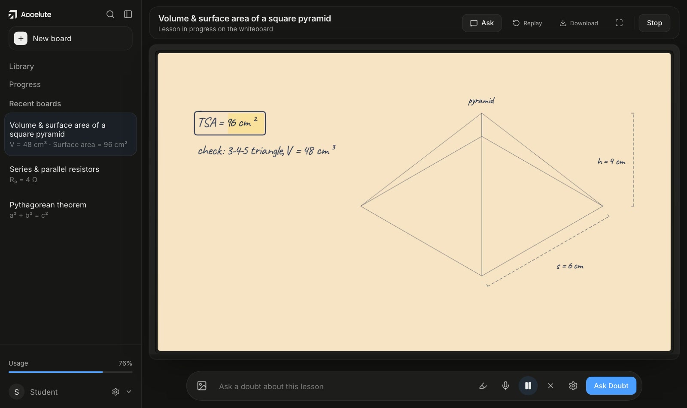
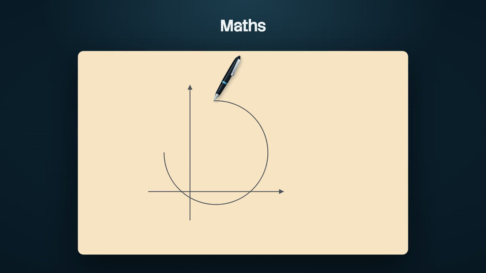
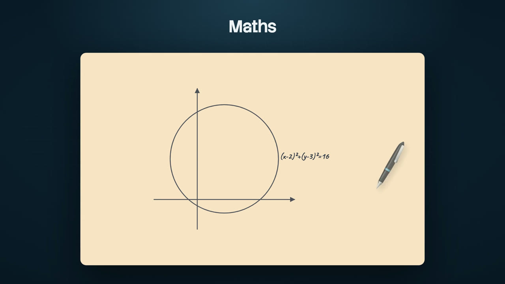
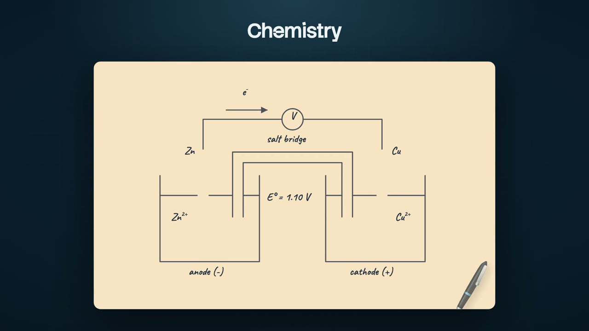
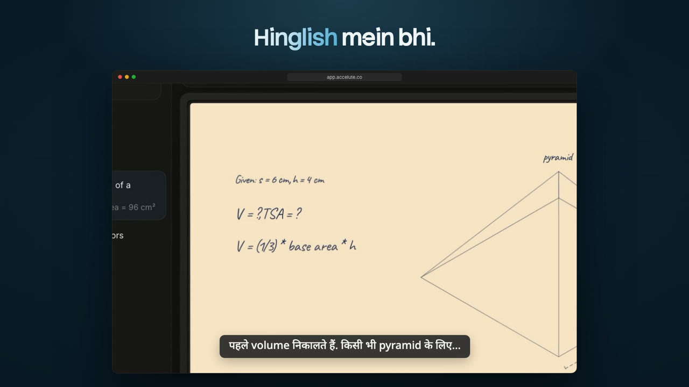

# Accelute

**The AI tutor that teaches on a whiteboard.**

Ask a question. Watch it draw the figure, write the working, and explain every step out loud.

[**Try it free**](https://app.accelute.co) &nbsp;·&nbsp; [Website](https://accelute.co) &nbsp;·&nbsp; [Watch a full lesson](https://accelute.co/hero/lesson-loop.mp4) &nbsp;·&nbsp; [Product Hunt](https://www.producthunt.com/products/accelute)

 

 

## Why Accelute

Most study tools answer in a chat box. You get a wall of text and a final number, but not the picture a good teacher would draw or the reasoning that gets you there.

Accelute teaches the way a teacher does at the board. It draws a clear, labelled diagram, writes each line of working beside it, and talks you through it while the ink appears. When you get stuck, you circle the step and ask, and the answer appears right there on the same board.

Think of it as a patient tutor that is ready whenever you are, for whatever you are studying tonight.

 

## See a real lesson

Here is a complete lesson, recorded exactly as a student sees it. Click the picture to watch it with sound.

  
   
  <b>▶ Watch the 3 minute lesson with sound:</b> a square pyramid, from the question to the checked answer.

 

## How it works

<table>
  <tr>
    <td width="50%" valign="top">
      
    </td>
    <td width="50%" valign="top">
      <h3>1. Ask anything</h3>
      
Type your question, snap a photo of the problem from your book, or just say it out loud. Ask in the same words you would use with your teacher.

      
Choose how deep to go: <b>New</b> if the topic is fresh, <b>Normal</b> for a regular lesson, or <b>Revision</b> for a quick recap before an exam.

    </td>
  </tr>
  <tr>
    <td width="50%" valign="top">
      <h3>2. Watch it unfold</h3>
      
Accelute plans the lesson, then teaches it on a live whiteboard. The figure is drawn and labelled, the working is written step by step, and a natural voice explains each line as the pen writes it.

      
Every diagram is checked before it is drawn, so what you see on the board matches the numbers in the question.

    </td>
    <td width="50%" valign="top">
      
    </td>
  </tr>
  <tr>
    <td width="50%" valign="top">
      
      
    </td>
    <td width="50%" valign="top">
      <h3>3. Circle it. Ask your doubt.</h3>
      
Lost on a step? Pause, circle the line you did not follow, and type or say your question. The tutor understands exactly which part you mean and explains it on the same board.

      
Then carry on from where you left off. Your doubt becomes part of the lesson instead of a separate chat.

    </td>
  </tr>
  <tr>
    <td width="50%" valign="top">
      <h3>4. Revisit at your own pace</h3>
      
Every lesson is saved to your library. Replay the board and the voice together, jump between chapters, slow it down or speed it up until it clicks.

      
Download the board as PDF notes, or the whole narrated lesson as a video, ready for revision whenever you need it.

    </td>
    <td width="50%" valign="top">
      
    </td>
  </tr>
</table>

 

## One board for every subject

Accelute draws the figure each subject needs: ray diagrams and circuits in physics, graphs and shapes in maths, cells and molecules in chemistry, and step by step walkthroughs for coding problems.

<table>
  <tr>
    <td width="33%"></td>
    <td width="33%"></td>
    <td width="33%"></td>
  </tr>
  <tr>
    <td align="center"><b>Physics</b> Optics, mechanics, circuits, waves</td>
    <td align="center"><b>Maths</b> Geometry, graphs, coordinate and 3D figures</td>
    <td align="center"><b>Chemistry</b> Cells, bonding, shapes of molecules</td>
  </tr>
</table>

 

## Hinglish mein bhi

Learn in English with an Indian, UK or US voice, or switch the tutor to Hinglish. Turn on subtitles to read along under the board.

  

 

## What makes it different

| | |
|---|---|
| ✍️ **A board, not a chat box** | You see the working and the figure side by side, not only the final answer. |
| 🎙️ **Voice and pen in sync** | The tutor speaks each line as it writes it, the way a real lesson feels. |
| ✅ **Figures you can trust** | Diagrams are checked against the question before they appear. If a figure cannot be drawn correctly, the tutor teaches without it rather than show something wrong. |
| 🖊️ **Doubts on the same board** | Circle any step and ask. No starting over, no copy and paste. |
| 📸 **Ask your way** | Type it, snap a photo of the problem, or say it out loud. |
| 🇮🇳 **Hinglish mein bhi** | Learn in English with an Indian, UK or US voice, or switch to Hinglish. |
| 🎚️ **Lessons that fit you** | Pick New, Normal or Revision and the lesson adjusts its depth. |
| 📚 **Keep everything** | Replay any lesson, jump to a chapter, and download notes or video. |

 

## Who it is for

- **School and college students** working through physics, maths, chemistry and coding homework.
- **Exam takers** who want a fast, visual recap of a topic the night before.
- **Self learners** who understand best when they can see it drawn.
- **Tutors and coaching centres** who want a whiteboard explanation ready for every question.

 

## Get started

Accelute runs in your browser, so there is nothing to install.

1. Open **[app.accelute.co](https://app.accelute.co)** and sign in with Google or your email.
2. Ask your first question, or pick one of the suggested problems.
3. Turn your sound on and watch the lesson unfold.

Start on the **Free plan**, and upgrade to **Plus** when you want more lessons. Plans are listed on [accelute.co](https://accelute.co).

> Accelute is a study companion, not a replacement for a qualified teacher. Like any AI, it can occasionally make mistakes, so double check anything important.

 

## About this repository

This repository holds everything behind Accelute: the tutor app, the website, and the engine that draws and checks every figure. If you are a developer looking for setup steps and design notes, start with the [developer guide](docs/DEVELOPMENT.md).

 

**[accelute.co](https://accelute.co)**

Learn every subject the way teachers actually teach it.

